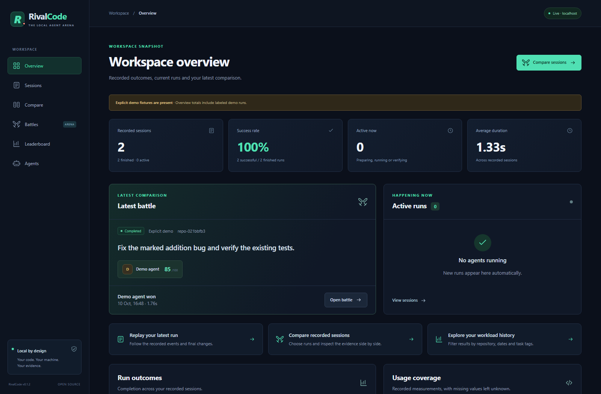
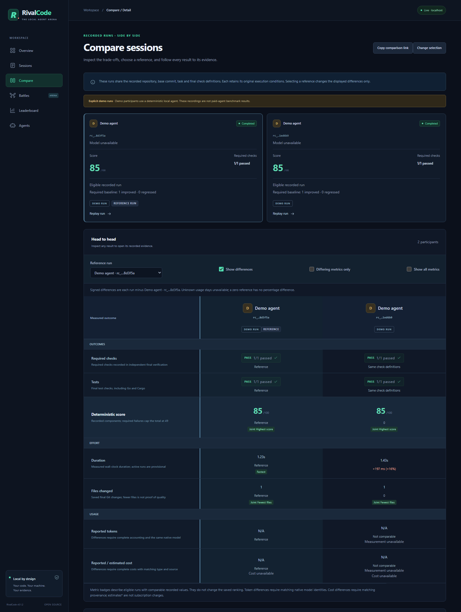
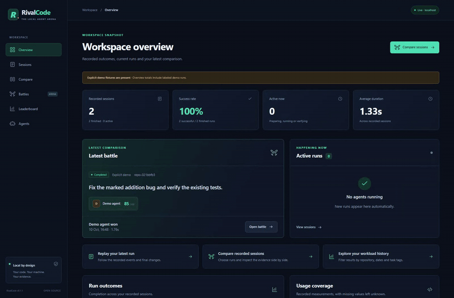
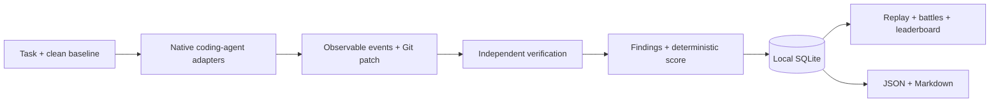

<div align="center">

# RivalCode

**Benchmark AI coding agents on your own repository.**

Codex · Claude Code · Gemini CLI · OpenCode

Same task. Same code. Same verification. Real evidence.

[](https://github.com/CanerBaba25/RivalCode/actions/workflows/ci.yml)
[](LICENSE)
[](https://nodejs.org/)
[](SECURITY.md)

[Quick start](#quick-start) · [Try the demo](#try-the-demo) · [Dashboard](#dashboard) · [Documentation](#documentation)

</div>

---

RivalCode is a local profiler, replay debugger and benchmark arena for coding
agents. Run a task, inspect what the agent actually did, and verify the resulting
code yourself. Compare agents from the same commit in separate Git worktrees,
with the same setup, checks and time limit.

No account, cloud backend or RivalCode telemetry. Your history lives in local
SQLite; the selected agent keeps using its own CLI, authentication and permissions.



The media use the explicit local Demo Agent. It performs real edits and runs
real tests; provider performance, model tokens and cost are not simulated.

[Watch the local demo](docs/images/demo.webm) · [Compare recorded runs](docs/images/comparison.png) · [Inspect the battle](docs/images/dashboard.png) · [Open the saved diff](docs/images/replay-diff.png)

## Quick start

Requires **Node.js 22.18+**, Git, pnpm 10, and at least one supported coding-agent
CLI configured under its own account.

```sh
git clone https://github.com/CanerBaba25/RivalCode.git
cd RivalCode
pnpm install --frozen-lockfile
pnpm build

# Install the built CLI locally; no npm release is required.
pnpm pack --pack-destination .rivalcode/packages
npm install -g .rivalcode/packages/rivalcode-0.1.2.tgz
```

Then, inside your project:

```sh
rivalcode init
rivalcode doctor

# Review rivalcode.config.json, especially setup and verification commands.
rivalcode run codex --task "Fix the login redirect and add tests"
rivalcode dashboard
```

The dashboard opens at `http://127.0.0.1:4317`. `--no-open` starts it without
launching a browser. Existing configuration is preserved by initialization.

## Put agents on the same starting line

```sh
rivalcode battle --agents codex,claude,gemini,opencode \
  --task "Implement request rate limiting and add tests"
```

Battles require a clean checkout and a committed `HEAD`. Every participant starts
in its own detached worktree at that exact revision. Runs are sequential by
default, reducing interference; `--parallel` is explicit and warns about fairness.
One failed agent does not prevent later participants from running.

RivalCode runs the configured checks itself. A fast patch with failing required
verification cannot beat an eligible passing result. Exact ties remain ties.

```text
Agent        Required checks  Score  Duration  Files  Tokens  Cost
-----------  ---------------  -----  --------  -----  ------  ----
Your agent   measured         /100   measured  actual native  N/A*
```

`N/A` means unavailable. Native reported accounting and estimated API-equivalent
cost are labeled separately; neither is presented as your subscription bill.
See the [scoring rules](docs/scoring.md).

## What you can inspect

| Feature                  | Evidence                                                                     |
| ------------------------ | ---------------------------------------------------------------------------- |
| Single-agent sessions    | Task, native events, exit status, duration and final patch                   |
| Independent verification | Baseline/final tests, lint, typecheck, build and custom checks               |
| Replay debugger          | Play/pause, previous/next, speed, event filters and linked evidence          |
| Git diff viewer          | Changed-file sidebar, additions/deletions, binary changes and readable hunks |
| Deterministic findings   | Repeated failures, regressions, forbidden paths and oversized patches        |
| Battle arena             | Same-commit worktrees, side-by-side metrics and transparent winner rules     |
| Recorded-run comparison  | Two to four saved sessions, reference differences and linked evidence        |
| Personal leaderboard     | Your recorded success rate, scores, time and available usage/cost            |
| Local exports            | Complete JSON or shareable Markdown reports                                  |
| Recovery                 | Persisted interrupted runs, bounded logs and ownership-aware cleanup         |

Intermediate edit diffs are not invented. Native tool events and final Git
observations are labeled according to what was actually captured.

## Dashboard

- **Overview:** finished-run outcomes, live activity, failure evidence and usage coverage.
- **Sessions:** sort and filter by agent, repository, status, dates and score.
- **Compare:** select two to four recorded runs, choose a reference and inspect differences.
- **Session detail:** checks, findings, usage, timeline playback and a lazy diff viewer.
- **Battles:** compare participants and open the evidence behind individual metrics.
- **Leaderboard:** personal workload statistics with repository/date/project/tag filters.

The bundled API and dashboard start together. Live updates observe the persistent
database, including runs from a separate CLI process. There are no fake production
responses or sample sessions inserted on startup.

Use the arrow keys or Home/End to move between session tabs. Replay links open the
matching saved file, and diff filters remain available for binary or metadata-only
changes. Session details and exports label partial token accounting explicitly.

Comparison selections survive filters, pages, **Change selection** and reloads in
the same browser tab when tab storage is available. **Copy comparison link** copies
a local URL that works while the same repository's dashboard is running. Use
JSON or Markdown exports for portable reports.



This view compares two recorded runs of the same Demo Agent. Historical
comparisons retain each run's original conditions and do not assign a battle winner.
Eligibility explanations and matched baseline checks show why a run qualifies and
which required checks improved or regressed. Missing or unmatched baselines remain
explicit. Token differences require complete observed native-model coverage with
a matching model and accounting scope; older unverified, mixed-model, or main-agent-only
token usage stays **Not comparable**. Claude's complete per-model totals include
subagents; its result-level fallback is labeled separately.
Cost differences require complete measurements with matching provenance. Missing
usage stays **N/A**.

## Supported agents

| Agent       | Native integration                      | Usage and accounting                                                         |
| ----------- | --------------------------------------- | ---------------------------------------------------------------------------- |
| Codex       | `exec --json`                           | Turn tokens; cost/model may be unavailable                                   |
| Claude Code | Headless `stream-json`                  | Per-model session totals; labeled main-agent fallback; estimated client cost |
| Gemini CLI  | Headless `stream-json`                  | Final token counts; native monetary cost unavailable                         |
| OpenCode    | JSON events + temporary observer plugin | Step tokens and native API-equivalent cost estimate                          |

Adapters expose their capture capabilities honestly. Missing optional agents do
not block an installed one. Existing vendor settings and permission policy are
preserved; RivalCode never automatically bypasses an approval or sandbox.

See [adapter setup and limitations](docs/adapters.md). Local automated tests cover
all four documented event schemas using sanitized fixtures. Test files are
intentionally excluded from this public repository. Paid live-agent runs are
separate, opt-in validation and are not implied by fixture tests.

## Try the demo

No agent subscription or model call is needed:

```sh
pnpm demo
```

This creates a new ignored demo repository with a deliberately broken addition
function, runs the labeled **Demo Agent**, verifies its real patch, and records
both a session and a battle. Use the printed command to open that repository's
dashboard, then select the recorded runs in **Compare**. Existing history and
your working project are untouched.



## CLI

```sh
rivalcode init
rivalcode doctor
rivalcode adapters
rivalcode run claude --task-file task.md
rivalcode battle --agents codex,gemini --task-file task.md
rivalcode sessions --agent codex
rivalcode show rc_<id>
rivalcode export battle_<id> --format markdown --output report.md
rivalcode export rc_<id> --format json
rivalcode dashboard --no-open
rivalcode cleanup
rivalcode uninstall-hooks
```

Use `--repo <path>` to select a repository. `--help` works for each command.
Task files are read as data; agent invocations use literal argument arrays.

## Local-first by default

- Local SQLite history, with no RivalCode telemetry or external collector.
- API bound to `127.0.0.1`, rejecting foreign Host/Origin requests.
- Secret redaction before storage, including dotenv values and common credentials.
- Tool output storage disabled by default; hidden reasoning is discarded.
- Session-owned OpenCode integration with reversible cleanup.

**Worktrees isolate repository changes, not OS permissions.** Agents run with
their own CLI and operating-system permissions. Local adapters cannot guarantee
network denial; unsupported deny-network settings fail explicitly. Review
[SECURITY.md](SECURITY.md) before running untrusted tasks or repositories.

## Architecture



Strict TypeScript, pnpm workspaces, a bundled Commander CLI, Hono/SSE, React/Vite,
Tailwind and Node SQLite. [Package boundaries and lifecycle](docs/architecture.md).

## Development

```sh
pnpm install --frozen-lockfile
pnpm typecheck
pnpm build
node dist/cli.js --help
pnpm demo

pnpm dev:cli --help
pnpm dev:web
pnpm dev
```

CI validates the build, types, CLI help and demo workflow on Linux, Windows
and macOS. ESLint configuration stays local; run `pnpm lint` when your local
config is available. Test suites/configuration remain local at the repository
owner's request; the public clone does not include them. Local tests use temporary
repositories and sanitized agent fixtures. No normal validation needs a paid
agent account. If you have the local suites, run `pnpm test` and `pnpm test:e2e`.
See [CONTRIBUTING.md](CONTRIBUTING.md).

## Documentation

- [Configuration reference](docs/configuration.md)
- [Agent adapters and capture fidelity](docs/adapters.md)
- [Architecture and persistence](docs/architecture.md)
- [Deterministic scoring and ranking](docs/scoring.md)
- [Integration ownership](integrations/README.md)
- [Security and privacy](SECURITY.md)

Hosted dashboards, global model rankings, full OS sandboxing, IDE extensions and
cloud synchronization are outside this local V1/V2 release.

## License

[MIT](LICENSE) © 2026 CanerBaba25.
