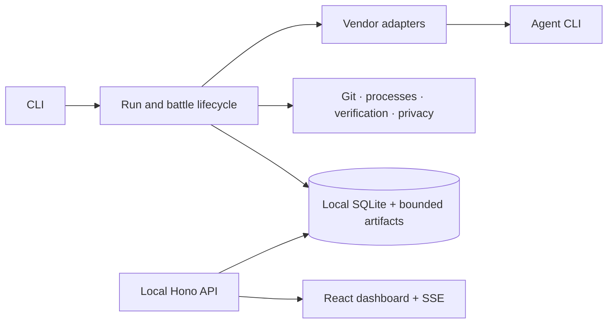

# Architecture

RivalCode is a local TypeScript/pnpm workspace. Its distributable CLI bundles the
workspace code and serves built React assets; users do not install a separate API
server. SQLite is provided by Node's built-in `node:sqlite`, requiring Node 22.18+.

| Boundary            | Responsibility                                                     |
| ------------------- | ------------------------------------------------------------------ |
| `packages/shared`   | Strict domain contracts                                            |
| `packages/runtime`  | Config, redaction, processes, Git, verification, typed persistence |
| `packages/adapters` | Documented native streams and reversible local integrations        |
| `packages/core`     | Lifecycle, events, findings, scores, ranking, export, cleanup      |
| `apps/cli`          | User commands, live progress, cancellation and actionable errors   |
| `apps/server`       | Paginated API, secure artifact reads and cross-process SSE         |
| `apps/web`          | Real recorded sessions, replay, diffs, battles and history         |

Runs persist `preparing`, `running`, `verifying` and terminal states. Startup
recovery marks dead-owner sessions aborted and skips live processes. Agent
timeout/cancellation saves partial evidence and keeps failed worktrees available
until explicit cleanup. Independent checks run after the agent exits.

Git baseline objects use an alternate index and unreachable commit-tree object;
they never change the user's branch, HEAD or staged index. This allows dirty
single runs to distinguish the agent patch from preexisting changes. Battles
require clean committed repositories and use detached worktrees from the exact
same base. Participants run sequentially by default; failures persist independently.

Numbered transactional migrations create repositories, sessions, events, usage,
file changes, verification runs, findings, battles and battle participants. Indexed
columns support paginated/filterable queries; typed documents retain complete
domain records. WAL allows the dashboard to read while the CLI writes. SSE
observes persistent changes across processes.

The event boundary filters native fields, drops reasoning, respects prompt/
assistant/tool-output settings and redacts before durability. Agent stdout is
decoded incrementally and never stored as a raw transcript. Verification logs,
event JSONL and final patches have byte caps. Complete timelines are stored in
SQLite and loaded in pages; large patches are loaded only when requested.

Privacy filtering preserves generated IDs, timestamps and protocol fields while
redacting user text, paths and configuration. This keeps event and verification
references intact even when a short dotenv value matches part of an identifier.
Artifact files are replaced atomically without writing through existing links.
Capture failures stop the agent process and retain a failed session; an evidence
write failure also prevents the result from being eligible to win.

Battle and historical comparisons share one evidence view. Historical selections
contain two to four persisted sessions and use shareable routes; selecting a
reference changes displayed differences without changing stored scores or ranks.
Different tasks, commits or required checks are flagged. Unknown usage stays
unknown, and token/cost differences require compatible model or accounting
provenance. The overview reports active runs, finished-run success rates and
measurement coverage separately, so missing data does not imply zero usage.

Comparison selections keep only session identifiers in tab-local browser storage.
Editing or reloading a comparison preserves the selection when storage is
available; blocked storage still permits current-view comparisons. Copied links
refer to the local server's history. Baseline changes match exact check IDs and
commands, and missing command capture cannot establish zero repeated failures.
Native model scope is persisted independently of cost provenance; legacy or
mixed-model token totals do not receive comparison deltas.
Claude token accounting separately records session-wide aggregates or a
main-agent-only fallback. A fallback or an older record without accounting scope
cannot establish a complete token comparison, even when native model IDs match.

See [scoring](scoring.md) for deterministic calculations and [adapters](adapters.md)
for fidelity and provider accounting limits.
